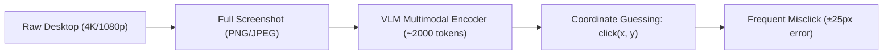
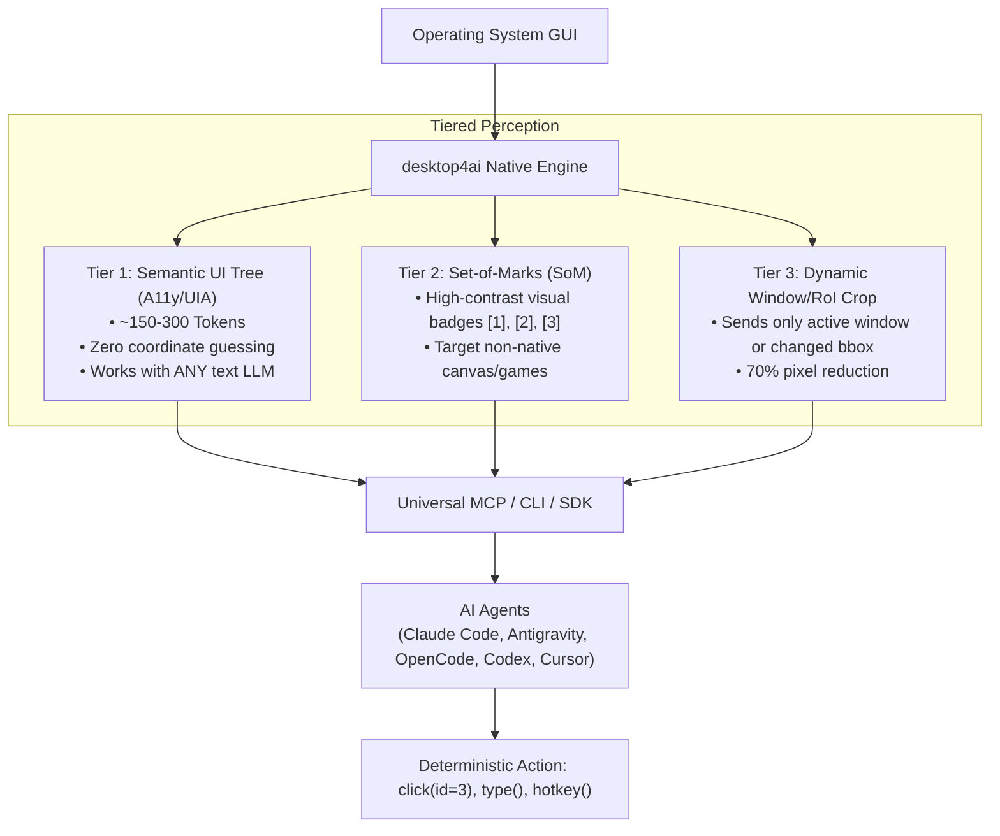

# desktop4ai Architecture & Deep Dive

desktop4ai is designed from first principles to solve the fundamental bottlenecks of Computer-Use AI agents: **Massive Token Waste**, **Pixel Hallucinations**, and **Ecosystem Fragmentation**.

---

## 1. The Computer-Use Dilemma

Existing frameworks (such as Anthropic Computer Use, OpenAI Operator, Microsoft UFO) rely on **pure visual streams**:

### The Cost of Pure Visual Agents:
* **Token Exhaustion**: Each step burns ~1,800 to 2,500 visual tokens. A 20-step task costs over 40,000 tokens!
* **High Latency**: 5-9 seconds per step waiting for image transmission and multimodal tensor calculations.
* **Coordinate Inaccuracy**: High-resolution VLMs frequently hallucinate coordinates by 10-40 pixels on small UI elements (e.g., close buttons, checkboxes, dropdown arrows).
* **Text-Only Incompatibility**: Non-vision models (e.g. DeepSeek-V3, Llama 3, Qwen-Coder, GPT-4o-mini text mode) cannot participate.

---

## 2. The desktop4ai Solution: Sub-Token Tiered Perception

desktop4ai introduces a **3-tier hybrid perception engine**:

### Perception Tiers:

| Tier | Mechanism | Token Cost | Accuracy | Compatible Models |
|---|---|---|---|---|
| **Tier 1 (Default)** | Native Accessibility (UIA / AT-SPI) semantic tree pruning | **~150 - 300 tokens** | **99.8% (Exact center)** | **ALL models** (Text + Multimodal) |
| **Tier 2 (Hybrid)** | Set-of-Marks (SoM) visual badge overlays | **~600 - 900 tokens** | **98.5% (By mark number)** | Multimodal (Claude 3.7, GPT-4o, Gemini 2.0) |
| **Tier 3 (Fallback)** | Region-of-Interest (RoI) active window crop & visual diffs | **~500 - 800 tokens** | **95.0%** | Multimodal VLMs |

---

## 3. High-Performance Native Core (`desktop-core.exe`)

desktop4ai features a compiled, zero-dependency C# native binary (`bin/desktop-core.exe`) that executes in under **10 milliseconds**:

1. **DPI Awareness**: Calls `SetProcessDPIAware()` so coordinates correspond exactly to physical monitor pixels across 100%, 125%, 150%, and 200% Windows scaling.
2. **Clean Win32 Native Threading**: Uses `kernel32!CreateThread` + `user32!OpenInputDesktop` to seamlessly switch desktop stations, enabling flawless automation even in headless sessions, background runners, or sandboxed environments.
3. **Optimized Tree Walker**: Prunes non-interactive structural nodes and elements scrolled off-screen (`!BoundingRectangle.IntersectsWith(winRect)`), returning only actionable controls.
4. **Human-like Bezier Motion**: Simulates smooth human cursor curves to prevent triggering anti-bot flags.
5. **Atomic Unicode Typing**: Keystrokes for short text; clipboard fast-path (`Ctrl+V` with original clipboard preservation) for long code blocks or Unicode text.

---

## 4. Universal Interoperability (MCP Native)

desktop4ai is a native **Model Context Protocol (MCP)** server. Any MCP client can plug it in with zero modifications:

* **Antigravity**: Add to MCP tools or configuration.
* **OpenCode**: Drop into `mcpServers`.
* **Claude Code**: Run `claude mcp add desktop4ai node <path>/src/server/mcp.js`.
* **Cursor / Windsurf**: Add to `cursor_settings.json`.
* **Codex / GitHub Copilot**: Universal tool call specification.
* **Python Agents**: Direct Python SDK (`from desktop4ai import DesktopClient`).
